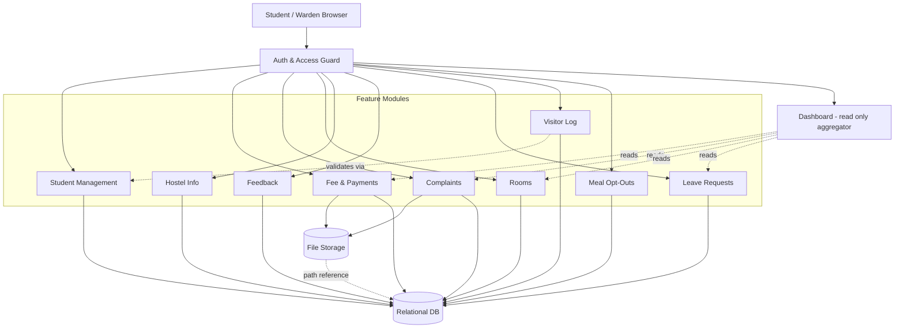

# HostelEase — Architecture

## 1. System Overview

HostelEase is a hostel management website for a hostel run by a single 
Hostel Warden. It has a public home page, a student area, and a warden 
area. The warden manages student records, fee-payment proofs, 
complaints, rooms, the visitor log, and hostel information in one 
place. Students log in with warden-issued credentials to view their 
own information and submit payment proofs, complaints, room requests, 
leave requests, meal opt-outs, and feedback. The system does not 
process payments; payments happen outside the site and the warden 
verifies uploaded proofs. (Final_PRD.md v1.2, §1)

## 2. Architectural Goals / Drivers

Goals G-01 to G-10 (Final_PRD.md §3), chiefly:
- One place for the warden to run day-to-day administration (G-01, 
  G-02, G-03, G-04, G-05, G-07, G-08, G-09, G-10).
- Students self-serve their own status without depending on the warden 
  for every enquiry (G-06, G-08, G-10).

Key architectural drivers: strict role/data isolation; a single 
source-of-truth fee calculation; a never-delete, status-based data 
model; file uploads as a storage concern separate from records; no 
payment-gateway integration; a performant, aggregating warden 
dashboard; room-capacity invariant enforcement; stable student identity 
across Left/Active transitions; and no client-specified technology, 
forcing an explicit human architecture-style decision.

## 3. Architecture Significant Requirements (ASRs)

| # | Source requirement(s) | Why architecturally significant | Architectural concern created |
|---|---|---|---|
| 1 | NFR-01, FR-02, FR-03, BR-08 | Two roles (student/warden) need hard data isolation | Authorization layer checked on every request, not UI-only hiding; strict boundary between student and warden portals |
| 2 | NFR-02, BR-03, BR-10 | Fee remaining/excess-paid must derive only from Verified proofs | Single source-of-truth / service layer for fee logic; no duplicate calculation across modules |
| 3 | BR-05, NG-04 | No record is ever deleted; corrections are by status change | Soft-state data model; delete operations excluded by design; audit/history trail |
| 4 | FR-04, C-02 | Payment proofs and complaint attachments (files, up to 5 MB) must be stored | File storage concern separate from DB records; storage location decision; validation layer |
| 5 | C-01, BR-02 | System does not process payments, only records proofs + manual verification | No payment-gateway integration in scope; must be explicit so the AI agent does not invent one |
| 6 | NFR-04, FR-14 | Dashboard aggregates data from multiple modules within 3 seconds | Modules must not be so isolated that dashboard aggregation becomes inefficient; clean aggregation interface needed |
| 7 | BR-06, FR-09 | Room capacity must never be exceeded; full rooms reject new assignments | Invariant-enforcement boundary between Room and Student modules |
| 8 | FR-13, BR-09 | A student marked Left is not deleted; reactivation reuses the same record | Student entity lifecycle/status design; identity must stay stable across Left → Active |
| 9 | C-04 | No technology or hosting was specified by the client | Forces an explicit human architectural-style decision rather than defaulting silently |
| 10 | BR-13, FR-18 | Visitor log is warden-only with zero student access — stricter than the general isolation rule | New privacy-boundary variant: an entity the student role cannot access at all, not even its own visitor record |
| 11 | FR-17, FR-19, FR-14 | Two new student-submitted, status/date-driven entities (leave, meal opt-out) | Resolved by ADR-005: Dashboard scope extended for Leave Requests only |

Excluded: NFR-03 (usability trial) is a test method, not an architectural driver. Standard CRUD requirements are covered by concerns #1 and #3 above.

## 4. Selected Architectural Style and Rationale

**Layered monolith** (ADR-001, Accepted) — a single deployable application organized into presentation, business-logic, and data-access layers. Selected over modular monolith and microservices because the scale (one warden, course-project traffic) does not justify distributed-system overhead, and a layered style still supports a cross-cutting Auth Guard and a read-only Dashboard aggregator.

**Clarification:** "Layered monolith" means one deployable application 
organized into presentation / business-logic / data-access layers — 
it does not mean a single global layers-first folder tree. In 
implementation, each module (Section 5) contains its own layers 
internally (routes / service / repository / schema). This is distinct 
from the rejected "modular monolith" alternative, which would mean 
modules deployable independently of one another.

## 5. Major Components / Modules

| Component | Responsibility | Owns data |
|---|---|---|
| Auth & Access Guard | Login, password change/reset, role check on every request (cross-cutting) | Credentials, sessions |
| Student Management | Student profile, register, search/edit, Left/reactivate | Student records |
| Fee & Payments | Fee record, proof upload, verify/reject, fee-change + payment history | Fee records, proofs |
| Complaints | Submit, categorize, status lifecycle, remarks | Complaint records |
| Rooms | Room CRUD, capacity, assignment, requests/swaps | Room + request records |
| Hostel Info | Announcements, menu, rules (CRUD by warden, read by student) | Announcements/menu/rules |
| Feedback | Star ratings, aggregated summary | Feedback entries |
| Leave Requests | Submit, approve/reject, status view | Leave request records |
| Visitor Log | Warden-only CRUD, validates student via Student Management's interface | Visitor log entries |
| Meal Opt-Outs | Opt-out/cancel by date+mealtype, own warden summary view (not read by Dashboard, per ADR-005) | Opt-out records |
| Dashboard | Read-only aggregator: Fee, Complaints, Rooms, Leave Requests (ADR-005) | None |
| File Storage (shared util) | Save/retrieve uploaded files for proofs + complaint attachments | Filesystem paths |

Boundary rules: each module owns its own tables; no module queries or writes another module's table directly — only through that module's defined interface. The Auth & Access Guard runs before every request reaches another module.

## 6. Interfaces / Interactions Between Components

- Dashboard calls `FeeService.getPendingCount()`, `ComplaintService.getPendingCount()`, `RoomService.getPendingRequestCount()`, `LeaveService.getPendingCount()` — no direct DB access, per ADR-005.
- Visitor Log calls `StudentService.exists(studentId)` before saving an entry — never joins the Student table directly.
- Every request passes through Auth & Access Guard first, which attaches the authenticated role before routing to a module.
- Meal Opt-Outs exposes its own `OptOutService.getSummary(date, mealType)` for its separate warden summary page — not called by Dashboard.

## 7. Relevant External Systems / Services

None. No payment gateway, no third-party integration (C-01). Payments happen outside HostelEase; the system only records proofs and warden verification (BR-02).

## 8. Important Data Responsibilities

Each module owns its own tables (Section 5). No shared tables across modules. File contents live on the filesystem, not in the database (ADR-004); only file-path references are stored relationally.

## 9. Architectural Constraints

C-01 (no payment processing), C-02 (file type/size limits), C-03 (warden-only administration, now including the visitor log), C-04 (no technology/hosting specified by client — resolved by ADR-001/002/003/004), BR-05 (no hard deletes), BR-12 (leave requests never alter Active status/room/login), BR-13 (visitor log never student-visible).

## 10. Architecture Diagram

## 11. Links to ADRs

- ADR-001 — Layered monolithic architecture
- ADR-002 — Data persistence (relational DB)
- ADR-003 — Authentication / access boundary
- ADR-004 — File storage approach
- ADR-005 — Dashboard scope (Leave Requests included, Meal Opt-Outs excluded)

## 12. Presentation-Layer Localization Note (VS-23)

- **Warden Dashboard English/Urdu Support (VS-23):** Implemented strictly within the **presentation layer** of the existing layered monolith (`ADR-001`).
- **Session-Based Preference (`ADR-003`):** The selected Warden Dashboard UI language (`en` default fallback or `ur`) is stored in the existing server-side Django session without adding new database tables, model columns, or migrations (`ADR-002` unchanged), and without introducing any external translation service or new framework.
- **Scope & Boundaries:** Renders Urdu labels for Warden Dashboard cards and navigation with `dir="rtl"` when `ur` is active, while keeping Dashboard read-only aggregation (`ADR-005`), Student views, and all backend service interfaces unchanged.