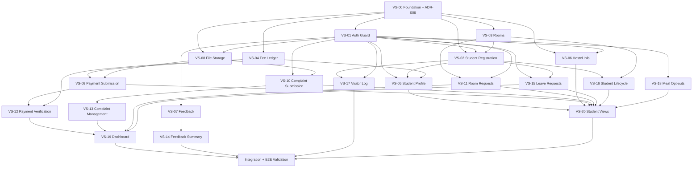

# HostelEase — Deliverable 4 Implementation Plan

**Document:** `plan.md`  
**Plan version:** v08 — All 21 vertical slices (VS-00 to VS-20) integrated and verified  
**Prepared:** 17 November 2026  
**Submission deadline:** 27 November 2026  
**Project:** SE-1001 — Introduction to Software Engineering  
**Product:** HostelEase  
**Team size:** 4 members  
**Implementation status:** Not started; no application code existed in the submitted D3 workspace.

---

## 1. Purpose and product objective

HostelEase is a hostel-management website for a single Hostel Warden and hostel students. It provides a public home page, a warden administration area and a student area. The warden manages student records, rooms, fees and payment proofs, complaints, hostel information, feedback, temporary leave requests, visitor records and meal opt-outs. Students can view only their own records and shared hostel information and submit the requests and records allowed by the PRD.

The system records payments made outside the application; it does **not** process online payments or integrate a payment gateway.

The objective of this plan is to deliver a working, locally runnable implementation of the approved D3 requirements by **27 November 2026**, using small, testable vertical slices and the Stage 4 AI-native implementation loop required by Deliverable 4.

### Success conditions

1. The implemented scope traces to the D3 Final PRD v1.2 and its acceptance criteria.
2. The product preserves the accepted D3 architecture and ADR constraints.
3. Every planned slice is implemented and checked within a maximum allocation of one working day.
4. All accepted slices are integrated into one runnable application.
5. Main end-to-end flows, important edge cases, role boundaries and fee/room invariants are demonstrated.
6. The team retains plan history, workflow evidence, AI iteration evidence, human decisions, integration evidence and contribution records.
7. The final product can be run locally using the documented instructions.

---

## 2. Authoritative project context and constraints

### 2.1 Source-of-truth documents

Use these submitted D3 documents as the approved project context:

- `Final_PRD_v1.2.md` — functional requirements, NFRs, business rules, constraints, flows, acceptance criteria and open questions.
- `architecture.md` — layered-monolith architecture and module responsibilities.
- `AGENTS.md` — coding-agent instructions, module boundaries, dependency rules and approval requirements.
- `ADR/ADR-001-architecture-style.md` — layered monolith.
- `ADR/ADR-002-data-persistence.md` — relational database; permits MySQL or PostgreSQL but does not itself select one.
- `ADR/ADR-003-authentication-boundary.md` — server-side sessions, not JWT; cross-cutting Auth & Access Guard.
- `ADR/ADR-004-File-Storage-Approach.md` — local filesystem with database path references.
- `ADR/ADR-005-dashboard-scope.md` — warden dashboard is a read-only aggregator of pending payment proofs, complaints, room requests and leave requests; meal opt-outs have a separate summary page.
- `Group_Contribution_Log.md` — previous member responsibilities and D3 contribution context.

For implementation, standardize the canonical PRD filename as `PRD.md` (copy the exact contents of `Final_PRD_v1.2.md`, without silently changing requirements). Update `AGENTS.md` references from `Final_PRD.md` to `PRD.md`. Preserve the original submitted D3 files as evidence.

### 2.2 Accepted architecture constraints

- One deployable **layered monolith**: presentation, business logic and data access layers.
- Preserve the feature/module boundaries in `AGENTS.md`; modules communicate through their defined service interfaces and must not directly query or write another module's tables.
- Auth & Access Guard is cross-cutting and runs before protected feature handling. Do not duplicate access enforcement in every feature module.
- Authentication uses server-side sessions, not JWT.
- The Dashboard owns no business data and performs read-only aggregation through service interfaces.
- Visitor Log is warden-only end to end; it has no student-facing route or API.
- Structured application records use a relational database.
- Payment-proof files and optional complaint attachments use the local filesystem; database records retain file-path references.
- Records identified by BR-05 are retained and are not hard-deleted. Rooms, announcements and menu entries may be removed only under the PRD's stated conditions.
- No online payment processing, payment gateway, cloud file storage, microservices or unapproved external service is introduced.
- Leave requests do not change student Active status, room assignment or login access (BR-12).
- Room capacity must never be exceeded (BR-06).
- Fee calculations must use verified payments only and preserve NFR-02.

### 2.3 Technology decisions for this implementation

The team has selected:

| Concern | Selection | Status / control |
|---|---|---|
| Backend framework | Django | Team-approved for D4; record in new ADR-006 before implementation |
| Database engine | PostgreSQL | Within the MySQL/PostgreSQL choice permitted by ADR-002; record specific selection in ADR-006 or a dated ADR-002 amendment |
| Frontend | Django templates, HTML, CSS and Bootstrap 5 | Implementation choice; keep server-rendered UI and avoid a separate SPA/API architecture |
| Authentication | Django authentication with server-side sessions | Must implement the existing ADR-003 boundary; not JWT |
| Database access | Django ORM and migrations | Use migrations as the schema-change history |
| File storage | Django-managed local filesystem storage | Must conform to ADR-004; database stores file references |
| Version control | Git, separate feature branches and daily integration | Branches are the team's selected workflow; GitHub is optional |
| Tests | Django test framework | Unit, integration and workflow tests |

**Approval gate:** D3 `AGENTS.md` says a new framework requires human approval and a new ADR. The team's selection in this plan is that approval. Before code is generated, create `ADR/ADR-006-technology-stack.md` documenting Django, PostgreSQL, server-rendered Django templates, local execution and the reasons for choosing them. Do not change ADR-001 to a different architecture style. PostgreSQL is a selection within ADR-002's permitted relational family, not a move away from relational persistence.

### 2.4 Team and responsibilities

Names and previous D3 roles are taken from the submitted D3 contribution log.

| Member | D3 context / strength | D4 primary ownership |
|---|---|---|
| Muhammad Fahad Basharat (Role-01) | ADR-001, ADR-005, ASR identification, decision facilitation | Rooms and room-request workflow; integration coordination |
| Safiullah (Role-02) | AGENTS.md, ADR-002, module boundaries and relational persistence | Student Management, data model conventions and database integrity |
| Adnanullah (Role-03) | ADR-003, authentication boundary, AI context handoff/evaluation | Shared UI/layout, file storage, hostel information and local run/deployment documentation |
| Farmanullah (Role-04) | architecture.md, ADR-004, packaging | Authentication and access guard; security review |

Ownership means one accountable slice lead. Other members review and test across the product. It does not prevent cross-training or shared fixes.

---

## 3. Implementation assumptions and open issues

### 3.1 Approved implementation assumptions

The following are **team-proposed implementation defaults** accepted for planning. Where the PRD labels a question open, these defaults must be recorded in a decision log/ADR and confirmed by the project team/client/TA as appropriate before the affected slice is accepted. This plan does not rewrite the PRD's open-question table or claim that the original client resolved these matters.

| PRD open question | Proposed implementation default | Affected slice(s) | Required record |
|---|---|---|---|
| OQ-02 public-page content | Public home page shows a concise HostelEase/hostel introduction only. Announcements/menu/rules remain authenticated student content unless the client confirms public visibility. | VS-01, VS-08 | Decision log |
| OQ-03 complaint reopening | No reopen action in initial implementation; Submitted → In Progress → Resolved only. | VS-13 | Decision log |
| OQ-04 / OQ-05 swap consent and effective time | Do not silently assume consent or automatic reassignment. Implement the request/review record and require explicit warden assignment update after approval; confirm whether the other student must consent before enabling swap approval. | VS-11, VS-17 | Decision log; approval gate |
| OQ-08 rejected proof resubmission | Rejected proof remains in history; student may submit a new proof record. Duplicate-proof detection is not added without a defined rule. | VS-09, VS-13 | Decision log |
| OQ-09 first warden account | Create the first warden through a documented Django management command usable by the local operator; no public warden registration. | VS-01 | ADR-006 / README |
| OQ-11 failed-login lockout | Do not add a lockout policy not specified by the PRD; rely on framework protections and document this limitation. | VS-01 | Decision log |
| OQ-12 resolved complaint remark | Require a remark when setting Resolved for this implementation, matching the proposed workflow; document as a team default. | VS-13 | Decision log |
| OQ-13 student marked Left with pending items/session/balance | Disable future login and clear room as FR-13 states; retain all records and balances. Do not delete or silently close pending records. Invalidate the user's active session on the next guarded request. Confirm treatment of pending items with the client/team. | VS-16 | Decision log |
| OQ-14 duplicate payment proof | No automated duplicate detection in this iteration; preserve each submission as a separate Pending record. Warden review remains authoritative. | VS-09, VS-12 | Decision log |
| OQ-15 reactivation when former room unavailable | Reactivate the same student record with room unassigned; warden assigns an available room later. This is consistent with AC-13.3's empty room field after reactivation. | VS-16 | Decision log |
| OQ-16 notifications | No email/SMS/push notifications. Students see status on their own pages. | All workflows | Existing PRD assumption A-04 |
| OQ-17 NFR targets | Treat 3-second page display and two-user/10-minute usability test as team targets, not client guarantees. Measure and report actual results. | VS-19, validation | Test report |
| OQ-18 categories/file size | Use the eight categories and 5 MB limit already binding in PRD assumption A-02 unless the warden changes them. | VS-09, VS-10 | PRD assumption |
| OQ-19 feedback details | Implement four 1–5 star aspects; allow repeat submissions and aggregate every saved entry. No text comment unless subsequently approved. | VS-14 | Decision log |
| OQ-20 payment amounts vs balance | Accept a positive payment amount and date; do not block an amount exceeding remaining balance because excess paid is supported by NFR-02/BR-10. Zero/negative amount is rejected. Several pending proofs may coexist; only Verified proofs affect paid totals. | VS-09, VS-12 | Decision log |
| OQ-21 registration if room full / partial failure | Use a database transaction for student, account, fee and room assignment creation. If the selected room is full, reject the registration transaction with a clear message; do not create a partial student/account record. Confirm this proposed behaviour. | VS-02, VS-03 | Decision log |
| OQ-22 payment validation and corrections | Warden verifies/rejects the submitted amount; no silent amount adjustment. Use positive amount validation. Verified proof records are immutable through ordinary UI; correction requires an explicit controlled correction path and audit note, if approved. Fee changes while proofs are Pending do not change their submitted amount. | VS-12 | Decision log |
| OQ-23 repeated complaints | Allow multiple complaint records; no duplicate blocking without a defined duplicate rule. | VS-10 | Decision log |
| OQ-24 room changes while requests pending | Revalidate capacity and current assignment at decision time. Reject an assignment if target is full; do not silently alter the request's target. | VS-11, VS-17 | Decision log |
| OQ-25 password setup/delivery | Generate a one-time temporary password via the controlled warden workflow/command; store only a secure password hash; require change at first login. Do not email or expose credentials publicly. Agree the actual handover method with the warden. | VS-01, VS-02 | Decision log |
| OQ-26 opening balances | Warden can enter initial fee total and opening verified paid amount through a controlled student/fee setup path, with an audit note; do not fabricate payment-proof files for historical payments. Confirm opening-balance workflow. | VS-02, VS-04 | Decision log |
| OQ-27 status transitions | Enforce the PRD status sets and allowed transitions in service functions; no direct arbitrary status editing. | VS-09–VS-18 | State-transition table |
| OQ-28 student-visible data/profile edits | Students see their own profile, room, fee, complaints and requests; roommate names/occupancy lists and visitor log remain warden-only. Students may change their password; other profile edits remain warden-owned unless the team confirms otherwise. | VS-05, VS-11 | Decision log |
| OQ-29 fee period/currency | Treat the fee as a total amount as currently stated; use a single configured currency label agreed by the team. Do not introduce recurring billing/due-date automation. | VS-04, VS-18 | Decision log |
| OQ-30 one open leave request | Enforce one open leave request per student, where open means Pending or Approved, matching the existing AGENTS.md instruction and AC-17.3. | VS-15 | Update PRD decision log and AGENTS.md consistently |
| OQ-32 visitor-log retention | Retain visitor entries; no visitor-log delete feature. This is the conservative choice under BR-05/AGENTS.md until a retention period is confirmed. | VS-17 | Decision log |
| OQ-33 same-day meal cutoff | Allow cancellation until the meal date begins; disallow cancellation once that date has passed. Do not invent a same-day clock-time cutoff. | VS-18 | Decision log |

### 3.2 Other open questions not fully resolved by this plan

The remaining PRD questions (including OQ-01, OQ-05, OQ-06, OQ-07, OQ-10, OQ-15, OQ-18, OQ-20, OQ-22, OQ-24 and OQ-28) must remain visible in the issue/decision log. The defaults above cover only the minimum implementation behaviour proposed for the current scope. If a decision materially changes a requirement, stop the affected slice and obtain team/client/TA confirmation rather than letting the coding agent infer a rule.

**Important consistency note:** `AGENTS.md` already states one open Pending/Approved leave request per student, while PRD OQ-30 is still open. The team has selected that behaviour for implementation. Record the decision in the PRD decision log and align `AGENTS.md`; do not leave contradictory project context for the coding agent.

---

## 4. Vertical-slice strategy and priority

A vertical slice is a small, independently testable increment that crosses the required presentation, business-logic and persistence layers. A slice is not complete when only its template, model or database table exists.

### Priority definitions

- **P0 — Foundation/core:** Required to establish the application, secure access, core records, rooms and fees.
- **P1 — Main workflows:** Required to demonstrate the main student and warden processes.
- **P2 — Supporting/remaining requirements:** Required PRD scope that follows the core workflows.
- **P3 — Integration and final validation:** Cross-slice quality and submission work.

All listed PRD features remain in the planned scope. Priority determines sequencing, not whether a requirement can be omitted.

### Slice acceptance rule

A slice may be marked **Accepted** only when:
1. Its listed acceptance criteria pass.
2. Its tests pass and relevant previous accepted tests still pass.
3. It respects architecture, ADRs, `AGENTS.md` and PRD constraints.
4. Human reviewer records Accept / Revise / Reject with a reason.
5. It is integrated into the shared branch.
6. Evidence and plan history are updated.

Every slice has a maximum one-working-day allocation. If the slice cannot meet that limit, split it into smaller slices before continuing; do not extend its duration silently.

---

## 5. Slice catalogue

### VS-00 — Project foundation and approved stack

- **Priority:** P0
- **Lead:** Adnanullah
- **Scheduled date:** 18 November 2026
- **Maximum duration:** 1 working day
- **Requirements/context:** ADR-001 to ADR-005; approved team technology choice; D4 Stage 2/3.
- **Dependencies:** None.
- **Scope:** Create the Django project; document ADR-006; configure PostgreSQL locally; establish settings separation, environment-variable handling, base URL routing, base templates, static files, app/module skeleton, migration workflow, Git repository and branch conventions; add a minimal health/home page.
- **Acceptance criteria:**
  - Application starts using documented local commands.
  - PostgreSQL connection succeeds.
  - Initial migrations apply from an empty database.
  - Base template and public landing route render.
  - Static assets load.
  - Feature branches can be created and merged.
  - ADR-006 records Django/PostgreSQL/server-rendered UI and local execution.
- **Checks:** Fresh database migration, application startup, home-page request, Git branch/merge smoke test.
- **HITL/AFK:** HITL for framework/database and structure decisions; AFK may generate boilerplate after the structure is approved.

### VS-01 — Authentication and cross-cutting access guard

- **Priority:** P0
- **Lead:** Farmanullah
- **Scheduled date:** 19 November 2026
- **Maximum duration:** 1 working day
- **Requirements:** FR-02, NFR-01, BR-01, BR-08, BR-09, BR-13; AC-02.1–AC-02.4; AC-NFR-01; ADR-003.
- **Dependencies:** VS-00.
- **Scope:** Warden/student login, server-side sessions, logout, role resolution, shared Auth & Access Guard, protected-route defaults, password change and forced temporary-password change hook. Add controlled first-warden creation command; no public student/warden self-registration.
- **Acceptance criteria:**
  - Valid warden and student credentials open their respective areas.
  - Invalid credentials are denied.
  - Logout invalidates the session.
  - Anonymous users can access only the public home/login routes.
  - Student cannot access warden-only routes, including visitor-log route, by direct URL.
  - Guard is cross-cutting and not reimplemented independently in each feature.
  - Passwords are stored using framework password hashing; no plaintext password persistence.
- **Checks:** Login/logout tests, anonymous route tests, role matrix tests, direct URL tests, password-change test.
- **HITL/AFK:** HITL; security boundary and session behaviour require human review.

### VS-02 — Warden student registration and initial fee/account creation

- **Priority:** P0
- **Lead:** Safiullah
- **Scheduled date:** 19 November 2026
- **Maximum duration:** 1 working day
- **Requirements:** FR-01; BR-01; AC-01.1–AC-01.4; proposed OQ-21/OQ-25/OQ-26 defaults.
- **Dependencies:** VS-00; VS-01 authentication contract; VS-03 room service contract.
- **Scope:** Warden registration form and service to create student, login account, fee record and room assignment in a single transaction; unique student ID; mandatory fields; initial fee and opening-balance path per approved decision.
- **Acceptance criteria:**
  - Warden can create a student with all mandatory PRD fields.
  - Duplicate student ID is rejected.
  - Missing mandatory values are rejected.
  - Student/account/fee/room records are created consistently or the transaction rolls back.
  - Full-room registration follows the recorded OQ-21 decision and leaves no partial records.
  - Student account is created with controlled initial/temporary credential handling.
- **Checks:** Valid registration, duplicate ID, missing fields, full room, transaction rollback, credential hash check.
- **HITL/AFK:** HITL; identity, account and fee data integrity.

### VS-03 — Room catalogue, assignment and capacity enforcement

- **Priority:** P0
- **Lead:** Muhammad Fahad Basharat
- **Scheduled date:** 19 November 2026
- **Maximum duration:** 1 working day
- **Requirements:** FR-09; BR-06; AC-09.1–AC-09.4.
- **Dependencies:** VS-00; student-service interface agreed with VS-02.
- **Scope:** Warden room creation/edit/removal, capacity, occupancy, assign/change/clear room; central room service for assignment and capacity checks.
- **Acceptance criteria:**
  - Warden can create and edit rooms and capacities.
  - Warden can assign a student to a room with free capacity.
  - Full room assignment is rejected.
  - Capacity cannot be reduced below occupancy.
  - A room with assigned students cannot be removed.
  - Occupancy reflects current assignments.
- **Checks:** Capacity boundary tests, concurrent/transactional assignment test where practical, room removal restriction.
- **HITL/AFK:** HITL; capacity invariant and transactional behaviour.

### VS-04 — Fee ledger and fee-change history

- **Priority:** P0
- **Lead:** Adnanullah
- **Scheduled date:** 19 November 2026
- **Maximum duration:** 1 working day
- **Requirements:** FR-06, NFR-02, BR-03, BR-10; AC-06.1, AC-06.2, AC-NFR-02.
- **Dependencies:** VS-00; agree fee/payment interface with VS-02.
- **Scope:** Fee record, verified-payment aggregation interface, total-fee changes, reason requirement when total falls below paid amount, fee-change history, remaining and excess-paid calculation.
- **Acceptance criteria:**
  - Warden can set/change total fee.
  - Old total, new total, date and reason (when entered) are recorded.
  - Payment history is not modified by a fee change.
  - Remaining = max(total fee − verified payments, 0).
  - Excess paid = max(verified payments − total fee, 0).
  - Lowering total below paid amount without a reason is rejected.
  - Pending and Rejected proofs do not affect paid totals.
- **Checks:** Unit tests for zero, underpaid, exact-paid and excess-paid scenarios; fee-change history test.
- **HITL/AFK:** HITL; financial calculations and audit history.

### VS-05 — Student profile and own-record boundary

- **Priority:** P0
- **Lead:** Farmanullah
- **Scheduled date:** 20 November 2026
- **Maximum duration:** 1 working day
- **Requirements:** FR-03, NFR-01, BR-08; AC-03.1–AC-03.2, AC-NFR-01.
- **Dependencies:** VS-01, VS-02, VS-03, VS-04 service interfaces.
- **Scope:** Student home/profile showing only own profile, room and summary links; shared information entry points; object-level ownership filtering.
- **Acceptance criteria:**
  - Student sees own profile and room information.
  - Student cannot retrieve another student's record by changing an ID in URL/query.
  - Student cannot see roommate names or warden-only occupancy lists.
  - Student can reach only their own complaints, requests and fee records through subsequent module interfaces.
- **Checks:** Two-student isolation tests; direct URL and object-ID substitution tests.
- **HITL/AFK:** HITL; privacy boundary.

### VS-06 — Hostel information: announcements, menu and rules

- **Priority:** P1
- **Lead:** Muhammad Fahad Basharat
- **Scheduled date:** 20 November 2026
- **Maximum duration:** 1 working day
- **Requirements:** FR-12; AC-12.1–AC-12.6; proposed OQ-02 default.
- **Dependencies:** VS-00, VS-01.
- **Scope:** Warden create/edit/remove announcements, menu and rules; authenticated student read-only pages; public home page remains limited to agreed public content.
- **Acceptance criteria:**
  - Warden can publish an announcement with non-empty title/message.
  - Warden can edit/remove permitted information entries.
  - Students can view published announcements, menu and rules.
  - Student attempts to create/edit/remove are denied.
  - Empty information state renders without error.
- **Checks:** Warden CRUD, student read-only access, empty-state and direct URL tests.
- **HITL/AFK:** AFK for basic templates/CRUD after requirements are clear; human review of public/student visibility.

### VS-07 — Feedback submission and warden rating summary

- **Priority:** P2
- **Lead:** Safiullah
- **Scheduled date:** 20 November 2026
- **Maximum duration:** 1 working day
- **Requirements:** FR-15, BR-11; AC-15.1–AC-15.4; proposed OQ-19 default.
- **Dependencies:** VS-01.
- **Scope:** Student submits 1–5 star ratings for food, rooms, washrooms and environment; warden sees counts per star level and aspect.
- **Acceptance criteria:**
  - Student can submit valid ratings for the four aspects.
  - Ratings outside 1–5 are rejected.
  - Repeated submissions create separate entries.
  - Earlier feedback cannot be edited by the student.
  - Warden summary counts ratings by aspect and star level.
- **Checks:** Rating validation, repeated submission, immutability and aggregation tests.
- **HITL/AFK:** AFK for form/summary implementation; human review of aggregation correctness.

### VS-08 — Shared local file-storage service

- **Priority:** P1
- **Lead:** Adnanullah
- **Scheduled date:** 20 November 2026
- **Maximum duration:** 1 working day
- **Requirements:** FR-04, FR-07, C-02, NFR-01; ADR-004.
- **Dependencies:** VS-00, VS-01.
- **Scope:** Shared upload validation and local filesystem storage for payment proofs and complaint attachments; database path reference; safe file naming; application-controlled file delivery with authorization.
- **Acceptance criteria:**
  - Only JPG, PNG and PDF up to 5 MB are accepted.
  - Unsupported extension/type and files above 5 MB are rejected.
  - Stored path reference is associated with the correct record.
  - Student cannot access another student's uploaded file by guessing its URL/path.
  - No cloud/external storage is introduced.
- **Checks:** Valid/invalid type and size tests; cross-student file-access test; filesystem/database reference test.
- **HITL/AFK:** HITL for access control and storage location; AFK for validation boilerplate.

### VS-09 — Student payment-proof submission

- **Priority:** P1
- **Lead:** Adnanullah
- **Scheduled date:** 21 November 2026
- **Maximum duration:** 1 working day
- **Requirements:** FR-04, BR-02, BR-03; AC-04.1, AC-04.2; F-03.
- **Dependencies:** VS-01, VS-04, VS-08.
- **Scope:** Student submits amount, payment date and one proof file; create Pending record; student can view own proof/status.
- **Acceptance criteria:**
  - Logged-in student can submit amount/date and JPG/PNG/PDF proof ≤5 MB.
  - New proof is saved as Pending.
  - Pending proof appears through the fee module's pending interface.
  - Invalid file type/size creates no proof record.
  - Only own proof/status is visible to student.
  - Application does not initiate or process a payment.
- **Checks:** Successful submission, invalid file, amount validation and ownership tests.
- **HITL/AFK:** HITL for amount/balance and file decisions; human review required.

### VS-10 — Student complaint submission and status view

- **Priority:** P1
- **Lead:** Farmanullah
- **Scheduled date:** 21 November 2026
- **Maximum duration:** 1 working day
- **Requirements:** FR-07; AC-07.1–AC-07.4; C-02; BR-05.
- **Dependencies:** VS-01, VS-08.
- **Scope:** Student submits one of eight PRD categories, description and optional attachment; status page shows status and warden remark.
- **Acceptance criteria:**
  - Category and description are mandatory.
  - Valid complaint is saved as Submitted.
  - Optional attachment obeys file type/size constraints.
  - Invalid attachment is rejected.
  - Student sees own complaint status and any warden remark.
  - Complaint record is retained; no hard-delete operation.
- **Checks:** Required-field validation, file validation, ownership, status and retention tests.
- **HITL/AFK:** HITL for privacy and attachment handling; AFK for form scaffolding.

### VS-11 — Student room request and swap request submission

- **Priority:** P1
- **Lead:** Muhammad Fahad Basharat
- **Scheduled date:** 21 November 2026
- **Maximum duration:** 1 working day
- **Requirements:** FR-10, BR-06, BR-07; AC-10.1–AC-10.4.
- **Dependencies:** VS-01, VS-03, VS-05.
- **Scope:** Student creates a room request or swap request with reason and target; sees own request; cancels Pending request.
- **Acceptance criteria:**
  - Request requires type, target/preferred room or swap target, and reason.
  - New request starts Pending.
  - Only one open room request per student is allowed.
  - Student can cancel Pending request; record becomes Cancelled and remains stored.
  - Non-existent swap target is rejected.
  - Student sees request status without seeing other students' private records.
- **Checks:** Required fields, one-open-request invariant, cancellation, invalid target and ownership tests.
- **HITL/AFK:** HITL for swap privacy and state rules.

### VS-12 — Warden payment verification/rejection

- **Priority:** P0
- **Lead:** Safiullah
- **Scheduled date:** 21 November 2026
- **Maximum duration:** 1 working day
- **Requirements:** FR-05, FR-06, NFR-02, BR-03; AC-05.1, AC-05.2, AC-NFR-02.
- **Dependencies:** VS-04, VS-08, VS-09.
- **Scope:** Warden pending-proof list and proof review; Verify or Reject with required rejection remark; transactional fee/payment-history update.
- **Acceptance criteria:**
  - Warden sees Pending proofs and can access the authorized proof.
  - Verify changes status to Verified and updates verified paid total, remaining, excess paid and payment history consistently.
  - Reject requires a remark and does not change paid/remaining values.
  - Student sees resulting status and rejection remark.
  - Only a Pending proof can be decided; repeated decision cannot double-count payment.
  - Related updates are atomic.
- **Checks:** Verify/reject tests, duplicate-click/idempotency test, transaction rollback and NFR-02 recalculation.
- **HITL/AFK:** HITL; financial and transactional integrity.

### VS-13 — Warden complaint management

- **Priority:** P1
- **Lead:** Farmanullah
- **Scheduled date:** 22 November 2026
- **Maximum duration:** 1 working day
- **Requirements:** FR-08; AC-08.1; BR-04; proposed OQ-03/OQ-12 defaults.
- **Dependencies:** VS-10, VS-01.
- **Scope:** Warden complaint list/detail; Submitted → In Progress → Resolved; add remark; student status view reflects changes.
- **Acceptance criteria:**
  - Warden can move Submitted complaint to In Progress and then Resolved.
  - Resolved action requires a remark under the recorded team default.
  - Student sees updated status and remark.
  - Student cannot change complaint status.
  - No reopen operation is offered in this implementation unless approved.
- **Checks:** Allowed transition tests, invalid transition tests, student read-only test.
- **HITL/AFK:** HITL for state transition and unresolved PRD assumptions.

### VS-14 — Warden feedback summary

- **Priority:** P2
- **Lead:** Safiullah
- **Scheduled date:** 22 November 2026
- **Maximum duration:** 1 working day
- **Requirements:** FR-15; AC-15.4.
- **Dependencies:** VS-07.
- **Scope:** Warden-only rating summary grouped by food, rooms, washrooms, environment and 1–5 star count.
- **Acceptance criteria:**
  - Warden can see count per star level for each aspect.
  - Counts include every retained feedback entry under the selected team default.
  - Students cannot access warden summary.
- **Checks:** Fixture-based aggregation comparison and role access test.
- **HITL/AFK:** AFK for aggregation view; human check of totals.

### VS-15 — Student temporary leave request and warden decision

- **Priority:** P1
- **Lead:** Muhammad Fahad Basharat
- **Scheduled date:** 22 November 2026
- **Maximum duration:** 1 working day
- **Requirements:** FR-17, BR-12; AC-17.1–AC-17.4; proposed OQ-30 decision.
- **Dependencies:** VS-01, VS-02.
- **Scope:** Student submits departure date, return date and reason; warden approves/rejects with remark on rejection; student sees result.
- **Acceptance criteria:**
  - Return date must be after departure date.
  - Valid request starts Pending.
  - One Pending/Approved leave request per student is enforced.
  - Warden can approve/reject; rejection includes remark.
  - Approval/rejection does not alter Active status, room assignment or login access.
  - Records are retained.
- **Checks:** Date validation, duplicate open request, status transition, no side-effect on student status/room/session and ownership tests.
- **HITL/AFK:** HITL; cross-module side-effect prevention.

### VS-16 — Student Left/reactivation lifecycle

- **Priority:** P1
- **Lead:** Safiullah
- **Scheduled date:** 22 November 2026
- **Maximum duration:** 1 working day
- **Requirements:** FR-13, BR-09; AC-13.1–AC-13.3; proposed OQ-13/OQ-15 defaults.
- **Dependencies:** VS-01, VS-02, VS-03.
- **Scope:** Warden marks Active student Left; login disabled; room cleared; reactivation reuses same student record and requires a new room assignment.
- **Acceptance criteria:**
  - Marking Left disables login and clears room.
  - Student, fee, payment, complaint and request histories remain.
  - Left student login is denied.
  - Reactivation restores the same student record and login.
  - No duplicate student ID record is created.
  - Room remains empty until warden assigns a room.
- **Checks:** Left login denial, retained history, reactivation identity and room-capacity tests.
- **HITL:** Mandatory; lifecycle touches authentication, rooms and retained records.

### VS-17 — Warden visitor log

- **Priority:** P2
- **Lead:** Muhammad Fahad Basharat
- **Scheduled date:** 23 November 2026
- **Maximum duration:** 1 working day
- **Requirements:** FR-18, BR-13, NFR-01; AC-18.1–AC-18.4; proposed OQ-32 default.
- **Dependencies:** VS-01, VS-02 student lookup interface.
- **Scope:** Warden creates visitor entry with visitor name, existing student, purpose and check-in; records check-out; no student-facing route or API.
- **Acceptance criteria:**
  - Warden can create an entry linked to an existing student.
  - Unknown student reference is rejected.
  - Warden can record check-out time.
  - Student cannot access visitor log through navigation or direct URL.
  - No hard-delete operation is offered while retention remains unresolved.
- **Checks:** Existing/non-existing student reference, check-out update, route discovery and direct URL authorization tests.
- **HITL:** Mandatory; strict privacy boundary.

### VS-18 — Student meal opt-out and warden summary

- **Priority:** P2
- **Lead:** Adnanullah
- **Scheduled date:** 23 November 2026
- **Maximum duration:** 1 working day
- **Requirements:** FR-19; AC-19.1–AC-19.5; proposed OQ-33 default.
- **Dependencies:** VS-01.
- **Scope:** Student opts out of breakfast/lunch/dinner on future date, cancels before the meal date, and warden sees count per date/meal. Separate page; not part of pending dashboard.
- **Acceptance criteria:**
  - Future date and valid meal type create Active opt-out.
  - Past-date opt-out is rejected.
  - Active opt-out can be cancelled before its meal date; status becomes Cancelled and record remains.
  - Cancellation after meal date has passed is rejected.
  - Warden summary counts by date and meal type.
  - Meal opt-outs are not added to the pending-items dashboard.
- **Checks:** Date boundaries, meal type validation, cancellation and summary aggregation tests.
- **HITL:** Human review for date-boundary behaviour and summary correctness.

### VS-19 — Warden pending-items dashboard

- **Priority:** P1
- **Lead:** Farmanullah
- **Scheduled date:** 23 November 2026
- **Maximum duration:** 1 working day
- **Requirements:** FR-14, NFR-01, NFR-04; AC-14.1, AC-14.2; ADR-005.
- **Dependencies:** VS-09, VS-10, VS-11, VS-12, VS-13, VS-15 and the room/leave service interfaces.
- **Scope:** Read-only dashboard aggregation of Pending payment proofs, Submitted/In Progress complaints, Pending room requests and Pending leave requests. No dashboard-owned business tables. Meal opt-outs excluded.
- **Acceptance criteria:**
  - Warden sees four distinct counts.
  - Each count matches its module's source records/statuses.
  - Dashboard reads through service interfaces only.
  - Dashboard has no independent copy of module business data.
  - Student access is denied.
  - Target page load is measured against provisional 3-second NFR-04.
- **Checks:** Known fixture counts, zero-count state, service-interface test, student direct URL denial and response-time measurement.
- **HITL:** Mandatory; cross-module aggregation and ADR-005 compliance.

### VS-20 — Student fee, payment and request-status views; end-to-end student home

- **Priority:** P1
- **Lead:** Adnanullah
- **Scheduled date:** 24 November 2026
- **Maximum duration:** 1 working day
- **Requirements:** FR-03, FR-04, FR-05, FR-06, FR-07, FR-10, FR-12, FR-13, FR-17, FR-19; AC-03.x, AC-04.x, AC-05.x, AC-06.x and relevant student-facing ACs.
- **Dependencies:** VS-05, VS-06, VS-07, VS-09, VS-10, VS-11, VS-12, VS-13, VS-15, VS-16 and VS-18.
- **Scope:** Complete student navigation and consolidated own-record views for fee balance, payment proof status/history, complaint status, room/leave request status, hostel information and opt-outs.
- **Acceptance criteria:**
  - Student can navigate to all implemented student functions from one coherent student area.
  - Student fee view shows total fee, verified paid amount, remaining, excess paid and payment history.
  - Student sees only own records/statuses.
  - Empty states do not produce errors.
  - No warden-only visitor log or administrative action is exposed.
- **Checks:** Student journey using two test accounts, object-level access tests, fee calculations and empty states.
- **HITL:** HITL for end-to-end privacy and correctness; AFK may assist with layout refinements.

---

## 6. Dependency map

The following is the logical dependency sequence. Work may proceed in parallel only where the upstream interface/schema contract has been agreed. A dependent slice is not Accepted until it passes against the real integrated dependency.



### Interface-first parallel work

Before each parallel cycle, the leads must agree on:
- Model ownership and field names.
- Service function names, inputs and outputs.
- Status values and allowed transitions.
- URL/route ownership.
- Permission expectations.
- Shared template and CSS conventions.

Use a short `supporting-artefacts/api-contracts.md` and `supporting-artefacts/data-model.md`. These are implementation aids, not a reason to redesign the D3 architecture.

---

## 7. Dated implementation and team allocation schedule

**Scheduling basis:** The current date is 17 November 2026. No coding has started. The deadline is 27 November 2026. The schedule therefore starts on 18 November and does not rely on earlier proposed dates that have already passed.

Each feature slice has a one-day maximum allocation. Four members can work in parallel. A daily integration/review checkpoint is included in each implementation day.

| Date | Member 1 — Fahad | Member 2 — Safiullah | Member 3 — Adnanullah | Member 4 — Farmanullah |
|---|---|---|---|---|
| **18 Nov** | Review room/service contracts; prepare room model proposal | Review schema and student model proposal | **VS-00 foundation + ADR-006** (lead); agree base templates and repo | Review auth/guard contracts and security matrix |
| **19 Nov** | **VS-03 Rooms** | **VS-02 Student registration** | **VS-04 Fee ledger** | **VS-01 Authentication** |
| **20 Nov** | Review room integration; help with room edge cases | **VS-07 Feedback** | **VS-06 Hostel information** + **VS-08 File storage** only if storage work is independent and both fit within their separate one-day limits; otherwise VS-08 is moved to 21 Nov and VS-06 remains the sole lead slice | **VS-05 Student profile** |
| **21 Nov** | **VS-11 Room requests** | **VS-12 Payment verification** | **VS-09 Payment-proof submission** | **VS-10 Complaint submission** |
| **22 Nov** | **VS-15 Leave requests** | **VS-14 Feedback summary** | **VS-08 File storage** if deferred from 20 Nov; otherwise cross-module integration support and tests | **VS-13 Complaint management** |
| **23 Nov** | **VS-17 Visitor log** | **VS-16 Student lifecycle** | **VS-18 Meal opt-outs** | **VS-19 Dashboard** |
| **24 Nov** | Room/leave integration review | Student/database integrity review | **VS-20 Student fee/payment/status views**; all members assist with integrated student navigation | Security and dashboard integration review |
| **25 Nov** | Cross-module integration and end-to-end room/leave flows | Database integrity, fee and feedback tests | File handling, UI and local-run integration tests | Role isolation, security and dashboard tests |
| **26 Nov** | Demo rehearsal and defect fixes | Demo rehearsal and defect fixes | README, local execution check, packaging and defect fixes | Demo rehearsal and defect fixes |
| **27 Nov** | Final submission and contribution confirmation | Final submission and contribution confirmation | Final submission and packaging confirmation | Final submission and evidence confirmation |

**Allocation correction / guardrail:** VS-08 is a one-day slice and must have exactly one lead-day. If it is completed on 20 November, Adnanullah must not be assigned a second full slice that day; VS-06 may instead be led by Fahad or moved to another member with capacity. The project coordinator must freeze the final allocation in the daily plan before work starts. The table deliberately exposes this scheduling choice rather than pretending one person can complete two full-day slices in parallel.

### Recommended clean allocation (authoritative)

To avoid double-booking, use this allocation as the final slice lead schedule:

| Date | Fahad | Safiullah | Adnanullah | Farmanullah |
|---|---|---|---|---|
| 18 Nov | Interface contract review | Data model contract review | VS-00 | Auth contract review |
| 19 Nov | VS-03 | VS-02 | VS-04 | VS-01 |
| 20 Nov | VS-06 | VS-07 | VS-08 | VS-05 |
| 21 Nov | VS-11 | VS-12 | VS-09 | VS-10 |
| 22 Nov | VS-15 | VS-14 | Integration support | VS-13 |
| 23 Nov | VS-17 | VS-16 | VS-18 | VS-19 |
| 24 Nov | Integration | Integration | VS-20 | Integration |
| 25 Nov | E2E tests | DB/fee tests | UI/file tests | Security tests |
| 26 Nov | Demo/fixes | Demo/fixes | Packaging/fixes | Demo/fixes |
| 27 Nov | Submission | Submission | Submission | Submission |

### Daily cadence

- **Start of day (15 minutes):** confirm slice ID, PRD criteria, dependencies, interface and branch.
- **Implementation:** one slice per assigned lead, maximum one working day.
- **Midday:** identify blockers; split scope if it cannot fit the one-day limit.
- **End of day:** run tests, conduct human review, integrate accepted branch, update workflow evidence and plan history.
- **Daily group sync (15–30 minutes):** each lead explains their change; every member understands integrated changes.

---

## 8. Integration strategy and branch policy

### 8.1 Branches

Use a protected shared integration branch (`main` or `develop`) and one feature branch per slice, for example:

- `feature/VS-01-auth-guard`
- `feature/VS-02-student-registration`
- `feature/VS-03-room-management`

A slice branch should:
1. Start from the latest shared integration branch.
2. Contain only the slice and necessary tests.
3. Include migrations and supporting artefacts where relevant.
4. Be reviewed by at least one member other than its lead.
5. Be merged only after tests pass and a human Accept decision is recorded.

Do not have multiple members independently edit the same migration or shared base template without coordination. Agree model ownership before creating migrations. If migrations conflict, one designated integrator resolves and reruns migrations from a clean database.

### 8.2 Integration checkpoints

- Daily after each implementation cycle.
- 24 November: complete feature integration.
- 25 November: end-to-end validation and regression.
- 26 November: final local deployment/demo rehearsal.

### 8.3 Integration acceptance

The integrated application must:
- Start from a clean checkout using README instructions.
- Apply all migrations to a fresh PostgreSQL database.
- Have no unresolved import, route, template or migration conflicts.
- Preserve module service boundaries.
- Pass all previously accepted slice tests.
- Have no broken role boundary or cross-student data access.
- Demonstrate the five principal workflows in Section 10.

---

## 9. Stage 4 AI-native implementation loop and evidence

The team must follow this loop for **every** vertical slice. Do not ask an AI agent to build the entire product in one prompt.

### 9.1 Required nine-step loop

1. **Select slice:** choose next prioritized slice and identify its PRD FR/AC references.
2. **Load relevant context:** provide only relevant PRD sections, architecture, ADRs, `AGENTS.md`, prior code and supporting artefacts.
3. **Refine criteria/tests:** confirm testable acceptance criteria and let the agent propose checks.
4. **Choose mode:** record HITL or AFK/delegated execution and a brief risk-based reason.
5. **AI implements:** ask the coding agent to implement only that slice; retain meaningful prompts and iteration/correction evidence.
6. **Run checks:** run slice tests and regression tests for prior accepted functionality.
7. **Human review:** lead/reviewer records Accept, Revise or Reject with reason.
8. **Integrate:** merge accepted branch and record commit/merge evidence.
9. **Update context:** update `plan.md`, supporting artefacts and ADRs where needed; preserve a new plan version.

### 9.2 HITL / AFK policy

| Work type | Default mode | Reason |
|---|---|---|
| Auth/session/access guard | HITL | Security-critical |
| Student registration and identity | HITL | Sensitive data and transactional consistency |
| Fee ledger/payment verification | HITL | Financial correctness |
| Room capacity/assignment/swap | HITL | Capacity invariant and cross-record updates |
| File storage and file authorization | HITL | Privacy and file-access risk |
| Student Left/reactivation | HITL | Lifecycle spans identity, rooms and history |
| Visitor log | HITL | Warden-only privacy boundary |
| Dashboard aggregation | HITL | Cross-module dependencies and ADR-005 |
| Simple CRUD templates and static layout | AFK may be used | Predictable, low-risk work |
| Repetitive form scaffolding | AFK may be used | Well-defined structure |
| Feedback/summary view | AFK for scaffolding, then human review | Aggregation correctness still needs verification |

AFK is not automatic acceptance. Every slice requires tests and a human Accept/Revise/Reject decision.

### 9.3 Workflow Evidence Log

Maintain `workflow-evidence/Workflow_Evidence_Log.md` with one entry per slice and these mandatory fields:

| Field | Required content |
|---|---|
| Slice ID/name | Exact plan identifier and title |
| Requirement references | FR, NFR, BR and AC IDs |
| Lead member | Accountable member |
| Acceptance criteria | Criteria used for review |
| Mode | HITL or AFK, with reason |
| Context/task reference | AI chat/task ID or retained prompt reference |
| Iterations | Important prompt corrections, failed attempts and revised approaches |
| Checks | Commands, test names, results and relevant output |
| Human decision | Accept / Revise / Reject and reason |
| Major issue/change | Important bug, ambiguity or scope adjustment |
| Plan version | Version used and version created after the slice |
| Integration status | Branch, commit/merge reference and date |

Also retain:
- Meaningful AI conversation exports/references.
- Feature branches and merge commits.
- Failed or rejected AI approaches and the correction that followed.
- Test outputs and screenshots where useful.
- Human review decisions.
- ADR/PRD/AGENTS updates and reasons.
- Daily contribution log updates.

Never fabricate prompts, test results, review decisions or timestamps. If evidence is missing, record it as missing and reconstruct only from actual Git/test/chat records.

### 9.4 Slice evidence template

Create `workflow-evidence/VS-XX.md` for each slice:

```markdown
# VS-XX — Slice title

- Date:
- Lead:
- Requirement references:
- Plan version at start:
- Branch:
- Mode (HITL/AFK) and reason:

## Acceptance criteria
- [ ] AC...
- [ ] AC...

## Context supplied to coding agent
- PRD sections:
- Architecture/ADR:
- AGENTS instructions:
- Supporting artefacts:
- AI chat/task reference:

## Implementation iterations
- Initial approach:
- Issue/failure:
- Correction/revision:
- Final implementation:

## Checks
| Test/check | Expected | Actual | Result |
|---|---|---|---|

## Human review
- Decision: Accept / Revise / Reject
- Reviewer:
- Reason:
- Follow-up work:

## Integration
- Commit:
- Merge date:
- Regression result:

## Plan/context update
- New plan version:
- ADR/PRD/AGENTS changes:
```

---

## 10. Stage 5 validation and demonstration plan

### 10.1 End-to-end workflows

The team must demonstrate at least these integrated flows:

**E2E-01 — Register and access**
1. Warden creates a student.
2. Student account is created.
3. Student logs in and changes temporary password.
4. Student sees their own profile and room.
5. Student is denied access to another student's record and warden pages.

**E2E-02 — Payment**
1. Student submits payment proof with amount/date/file.
2. Proof appears as Pending for warden.
3. Warden verifies it.
4. Fee ledger and payment history update atomically.
5. Student sees Verified status and updated remaining/excess-paid values.
6. A rejected proof does not alter paid/remaining totals.

**E2E-03 — Complaint**
1. Student submits categorized complaint and optional attachment.
2. Warden sees it in pending work.
3. Warden moves it to In Progress and Resolved with remark.
4. Student sees status and remark.

**E2E-04 — Room request**
1. Student submits room request or swap request.
2. Warden reviews and rejects or approves.
3. Warden explicitly updates assignment where appropriate.
4. Capacity is rechecked at assignment time.
5. Student sees final status and room.

**E2E-05 — Leave and dashboard**
1. Student submits valid temporary leave request.
2. Warden approves/rejects.
3. Student Active status, room and login access remain unchanged.
4. Dashboard pending leave count updates.

**E2E-06 — Visitor privacy**
1. Warden creates visitor entry for an existing student.
2. Warden records check-out.
3. Student direct URL access is denied.
4. Unknown student reference is rejected.

**E2E-07 — Meal opt-out**
1. Student opts out of a future meal.
2. Student cancels before the meal date.
3. Warden sees date/meal count.
4. Meal opt-outs do not appear in pending dashboard counts.

### 10.2 Core edge-case checks

- Duplicate student ID.
- Full room and capacity below current occupancy.
- Student direct URL access to another student's record.
- Student access to every warden-only page, especially Visitor Log.
- Invalid/oversized upload.
- Pending or Rejected payment not counted as paid.
- Repeated verification does not double-count a payment.
- Fee total below verified paid amount requires a reason and shows Excess paid.
- Invalid complaint fields and invalid status transition.
- Second open room request rejected; Cancelled request retained.
- Leave return date must be after departure; only one Pending/Approved request.
- Leave decision does not change Active status, room or login access.
- Left student cannot log in; reactivation reuses same record.
- Visitor log has no student route/API.
- Meal opt-out cannot be created for past date or cancelled after meal date.
- Dashboard counts exactly the four types in ADR-005.

### 10.3 Non-functional checks

- **NFR-01:** role and object-level access checks, including direct URL tests.
- **NFR-02:** fee calculation after each payment verification and fee change.
- **NFR-03:** two first-time test users attempt register-student and verify-payment tasks; record completion time and help required. Target: each under 10 minutes.
- **NFR-04:** measure login, student fee page and warden dashboard request-to-visible-content time on normal broadband. Target: under 3 seconds. Record environment and measurements; do not claim a target passed without evidence.
- **File storage:** test filesystem persistence and application-authorized access.
- **Data retention:** verify no hard-delete controls for records governed by BR-05.

### 10.4 Validation schedule

| Date | Activity | Lead/participants | Output |
|---|---|---|---|
| 24 Nov | Feature integration completion | All members | Integrated application |
| 25 Nov | Main E2E flows and regression | All; each owner leads own flow | E2E test log |
| 25 Nov | Security, fee, room and file edge cases | Farmanullah, Safiullah, Fahad, Adnanullah | Validation evidence |
| 26 Nov | Local deployment from clean checkout | Adnanullah + all | Verified README/run instructions |
| 26 Nov | Demo rehearsal and defect fixes | All | Demo checklist and final known-issues list |
| 27 Nov | Submission | All | Final package |

---

## 11. Supporting artefacts to generate (D4 Stage 3)

Generate only artefacts needed to guide implementation. Keep them in `supporting-artefacts/` and use them as context for relevant slices.

| Artefact | Minimum contents | When needed |
|---|---|---|
| `data-model.md` | Entities, ownership, relationships, status fields, history/retention | Before VS-02 to VS-04 |
| `api-contracts.md` | Service interfaces, inputs/outputs, error cases, ownership | Before parallel slice work |
| `state-transitions.md` | Allowed statuses/transitions for proofs, complaints, room requests, leave, meal opt-outs and student | Before workflow slices |
| `test-cases.md` | PRD AC mapping to tests | During each slice |
| `ui-wireframes.md` | Warden/student navigation and key forms | Before templates |
| `module-map.md` | Django app/package responsibilities and permitted dependencies | Before implementation |
| `README.md` | Prerequisites, PostgreSQL setup, environment variables, migrations, initial warden command, run/test commands | Start VS-00; finalize by 26 Nov |

Supporting artefacts may be AI-generated autonomously as D4 permits. UI wireframes may be reviewed and revised by the team. Any artefact that becomes implementation context must be retained.

---

## 12. `plan.md` history and change control

`plan.md` is a living artefact and its history is mandatory under D4.

### 12.1 Versioning rule

- Save this baseline as `plan-history/plan-v01.md` when implementation starts.
- Keep root `plan.md` as the latest version.
- After every material change to slice order, dependencies, scope, decisions, acceptance criteria, ownership, schedule or implementation understanding:
  1. Update root `plan.md`.
  2. Save a numbered snapshot `plan-history/plan-vNN.md`.
  3. Add an entry to the change log below.
  4. Commit both the current plan and snapshot to Git.
- Do not create meaningless versions for spelling-only changes.
- Do not overwrite old snapshots.
- Git history is supplementary; retain the numbered snapshots because D4 explicitly requires retrievable history.

### 12.2 Change log

| Version | Date | Change | Reason / evidence | Approved by |
|---|---|---|---|---|
| v01 | 17 Nov 2026 | Initial baseline: stack, 21 slices, dependencies, leads, schedule, acceptance criteria and evidence process | D3 context + D4 instructions + team technology selections | Team |
| v02 | 21 Nov 2026 | Slices VS-00, VS-01, VS-04, VS-06, and VS-02 implemented and accepted; test coverage updated | Implementation progress and workflow evidence | Team |
| v03 | 22 Nov 2026 | Cycle 2 integration complete: VS-03 merged & accepted; restored VS-04 finance routes & VS-06 hostel-info routes/views/tests; synced hostel migrations & warden dashboard links | All unit, integration, and Cycle 2 E2E tests passing | Team |
| v04 | 22 Nov 2026 | Cycle 3 complete: VS-05 (Student Profile), VS-07 (Feedback), and VS-08 (Shared Local File Storage) implemented, integrated, and accepted | `operations` 20 tests OK + full suite verified | Team |
| v05 | 24 Nov 2026 | Cycle 4 (VS-09–VS-12) & Cycle 5 (VS-13–VS-15) integrated and verified; dashboard links wired for Complaints & Leave Requests | 190 tests OK + Cycle 5 integration tests passing | Team |
| v06 | 24 Nov 2026 | Cycle 6 VS-16 (Student Left/reactivation lifecycle) implemented, tested, and merged into main | `hostel.test_student_lifecycle` 5 tests OK | Team |
| v07 | 24 Nov 2026 | Cycle 6 VS-17 (Visitor Log) & VS-18 (Meal Opt-Outs) implemented and verified on branch `vs-18` | `operations.test_meal_optouts` 7 tests OK | Team |
| v08 | 24 Nov 2026 | Cycle 6 VS-19 (Warden Dashboard) & Cycle 7 VS-20 (Consolidated Student Home) integrated and verified; all 21 slices (VS-00–VS-20) accepted | Full suite: `Ran 220 tests in 195.102s — OK` | Team |

### 12.3 Plan-change triggers

Create a new version when:
- A PRD open question is resolved or changes scope.
- A slice is split, merged, reprioritized or moved.
- A dependency/interface changes.
- A technology or architecture decision changes.
- A slice is rejected or revised in a way that affects other work.
- Integration reveals a new dependency or significant design constraint.
- A deadline or member allocation changes.

Each update must state what changed, why, affected slices, impact on dependencies/schedule, and who approved it.

---

## 13. Group contribution and knowledge sharing

Continue the existing D3 `Group_Contribution_Log.md`; do not replace prior entries.

For D4, append dated entries linking each member to:
- Slice IDs led.
- AI prompts/tasks and iterations.
- Human review decisions.
- Defects fixed and tests run.
- Branches/commits/merges.
- Integration and documentation work.
- Architecture or requirement decisions.

Every member must be able to explain:
- Product objective and user roles.
- Layered-monolith architecture and module boundaries.
- Why Django/PostgreSQL were selected.
- Session-based Auth Guard and privacy model.
- Fee consistency and room-capacity invariants.
- File storage decision.
- Dashboard aggregation and ADR-005.
- At least one AI implementation loop, revision/rejection and test result.
- Main product workflows and limitations.

Schedule a short cross-member walkthrough daily so ownership does not create knowledge silos.

---

## 14. Final report and CCP analysis

The final report must cover:
- Implemented scope mapped to PRD requirements.
- Architecture and implementation summary.
- Key technical challenges and how they were addressed.
- Testing and validation results, including measured NFR evidence.
- Known limitations and unresolved decisions.
- Group contribution summary.
- CCP analysis.

### CCP analysis prompts

1. **Problem statement:** Explain the real hostel administration gap and why disconnected manual records create problems.
2. **Complexity drivers:** Explain interacting modules, strict student/warden data isolation, fee consistency, room capacity, retained histories, file handling and cross-module dashboard aggregation.
3. **Trade-off:** Discuss usability/convenience versus security/privacy, or simple local filesystem storage versus portability/backup complexity.
4. **Alternatives:** Reuse ADR-001/002/003/004 reasoning and compare at least two alternatives, including why the selected approach fits this project's scale and constraints.
5. **System integration:** Explain how Auth Guard, Student Management, Fee & Payments, Rooms, Complaints, Leave Requests and Dashboard interact through service interfaces.
6. **Solution evaluation:** Include test pass evidence, task completion time, page response measurements or another meaningful metric actually measured.
7. **Scalability/feasibility:** Explain limits of a single-warden layered monolith and local filesystem at larger scale, without claiming the course project is production-hardened.
8. **Ethical/societal impact:** Address student privacy, visitor information, credential security, payment evidence, data retention, accessibility and responsible handling of sensitive records.

---

## 15. Final submission checklist

### Product and source
- [ ] Working application source and required files.
- [ ] Fresh PostgreSQL database can be migrated.
- [ ] Local execution instructions work from a clean checkout.
- [ ] No unapproved external services or payment integration.
- [ ] No unresolved critical integration or authorization defects.

### Project context
- [ ] Canonical `PRD.md` (faithful copy of Final PRD v1.2).
- [ ] `architecture.md`.
- [ ] Updated `AGENTS.md`.
- [ ] ADR-001 through ADR-006.
- [ ] Latest `plan.md`.
- [ ] All numbered plan history snapshots.
- [ ] Supporting artefacts used by implementation.
- [ ] `README.md`.

### AI-native workflow evidence
- [ ] Workflow Evidence Log has an entry for every slice.
- [ ] AI task/chat references retained.
- [ ] Important iterations, corrections and rejected/revised approaches retained.
- [ ] Test results recorded.
- [ ] Human Accept/Revise/Reject decisions recorded.
- [ ] Branch and integration evidence retained.
- [ ] Context and plan updates versioned.

### Validation and report
- [ ] Main end-to-end workflows demonstrated.
- [ ] Core FRs and important edge cases checked.
- [ ] NFR-01 and NFR-02 verified.
- [ ] NFR-03 and NFR-04 measured/reported where practical.
- [ ] Final Project Report includes CCP analysis and limitations.
- [ ] Group Contribution Log updated.
- [ ] All four members can explain the product and major decisions.
- [ ] Final demo rehearsed before 27 November.

---

## 16. Current status

### Completed & Accepted Slices (as of 22 Nov 2026)
| Slice ID | Slice Title | Lead | Status |
|---|---|---|---|
| VS-00 | Project foundation and approved stack | Adnanullah | Accepted |
| VS-01 | Authentication and cross-cutting access guard | Farmanullah | Accepted |
| VS-02 | Warden student registration and initial fee/account creation | Safiullah | Accepted |
| VS-04 | Fee ledger and fee-change history | Adnanullah | Accepted |
| VS-06 | Hostel information: announcements, menu and rules | Muhammad Fahad Basharat | Accepted |
| VS-03 | Room catalogue, assignment and capacity enforcement | Muhammad Fahad Basharat | Accepted |
| VS-07 | Feedback submission and warden rating summary | Safiullah | Accepted |
| VS-11 | Room-change and two-step room-swap requests (Accepted 2026-11-22) | Muhammad Fahad Basharat | Accepted |
| VS-09 | Student payment proof submission and fee/proof view (Accepted 2026-11-23) | Adnanullah | Accepted |
| VS-12 | Warden payment verification/rejection with atomic ledger update (Accepted 2026-11-23) | Safiullah | Accepted |
| VS-10 | Student complaint submission and status view | Farmanullah | Accepted |
| VS-13 | Warden complaint management | Farmanullah | Accepted |
| VS-14 | Warden feedback summary | Safiullah | Accepted |
| VS-15 | Student temporary leave request and warden decision (Accepted 2026-11-23) | Muhammad Fahad Basharat | Accepted |
| VS-16 | Student Left/reactivation lifecycle | Safiullah | Accepted |
| VS-17 | Warden visitor log (Accepted 2026-11-24) | Muhammad Fahad Basharat | Accepted |
| Remaining (VS-05, VS-08, VS-18 to VS-20) | Remaining planned slices | Designated leads | Scheduled / In Progress |

| Status | Meaning |
|---|---|
| Not Started | No implementation work recorded |
| In Progress | Lead has started the slice |
| In Review | Implementation complete; tests/review pending |
| Revise | Human reviewer requested changes |
| Accepted | Criteria pass, human acceptance recorded and integrated |
| Blocked | Waiting for a dependency or decision |
| Rejected | Proposed implementation not accepted; reason recorded |

**Baseline status:** Planning complete; technology choices selected by the team; ADR-006, canonical context-file alignment and open-question decision records are the first implementation prerequisites.

**Deadline:** 27 November 2026.  
**Practical code-complete target:** 24 November 2026.  
**Final validation/demo target:** 26 November 2026.
